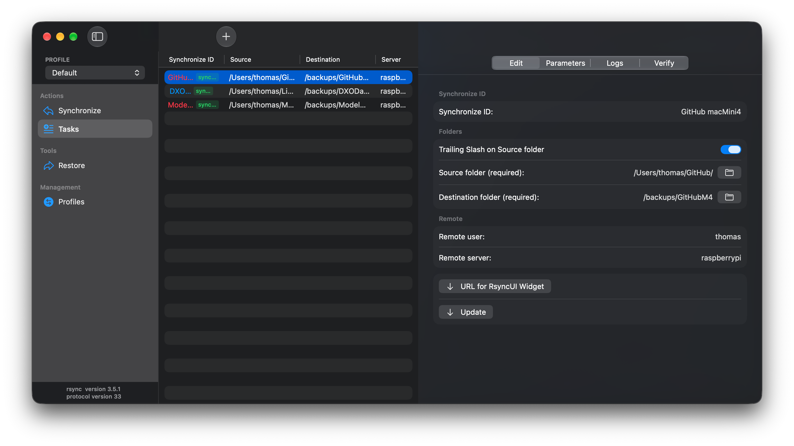
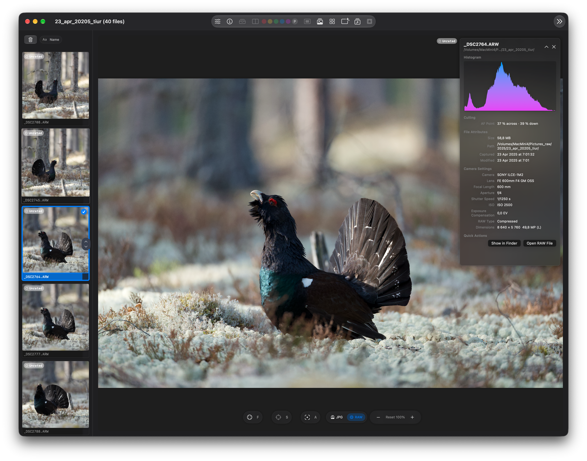
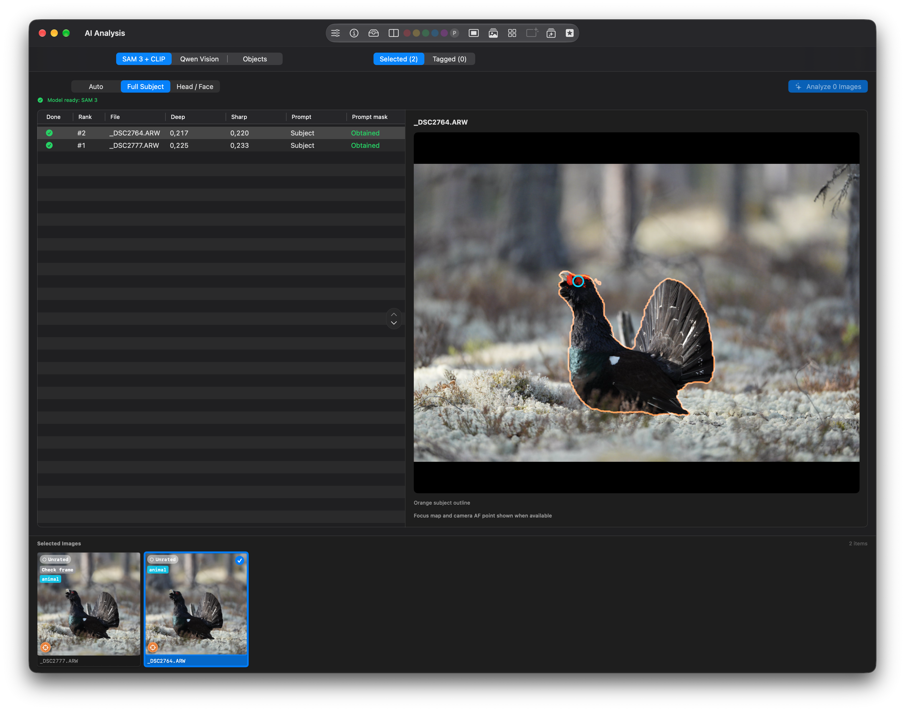
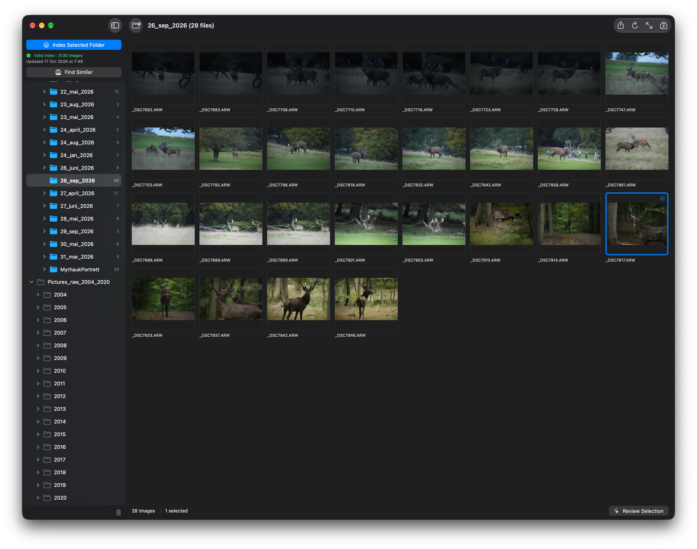
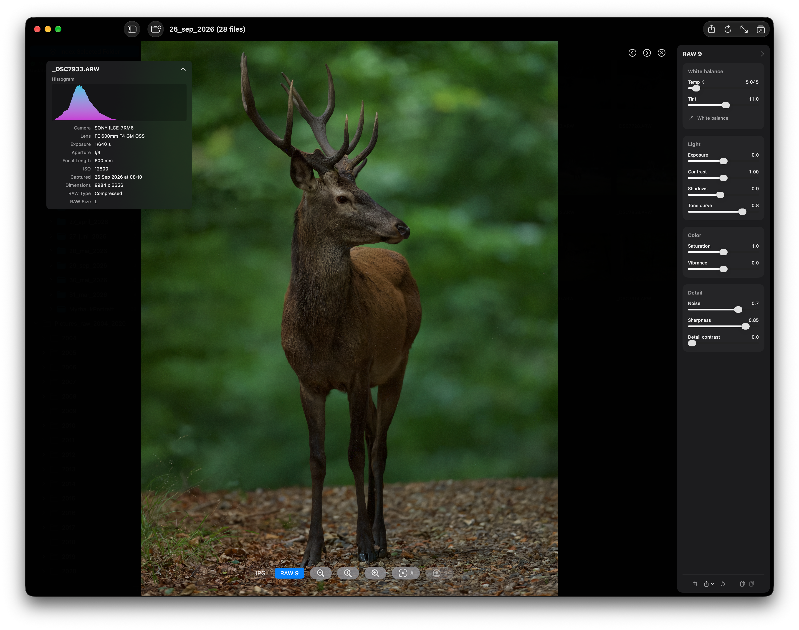

# macOS apps by Thomas (rsyncOSX)

Native macOS applications for file synchronization, photo culling, and private on-device image search. All three applications are actively developed, and their core processing stays on your Mac.

| Application | Purpose | Requirements |
| --- | --- | --- |
| [RsyncUI](#rsyncui) | Graphical file synchronization with `rsync` | macOS Sonoma and later |
| [RawCull](#rawcull) | AI-assisted Sony RAW photo culling | Apple Silicon, macOS Golden Gate |
| [RawBrowse](#rawbrowse) | Photo browsing, local AI search, and RAW editing | Apple Silicon, macOS Golden Gate |

---

## RsyncUI

[](https://github.com/rsyncOSX/RsyncUI/blob/main/Licence.MD)

[](https://github.com/rsyncOSX/RsyncUI/issues)

A native SwiftUI interface for [`rsync`](https://github.com/WayneD/rsync) that makes synchronization tasks easier to configure, organize, and schedule. RsyncUI configures and runs `rsync`; all file synchronization is performed by `rsync` itself.

[Download](https://github.com/rsyncOSX/RsyncUI/releases) · [Documentation](https://rsyncui.netlify.app/docs/) · [Release notes](https://rsyncui.netlify.app/blog/) · [Report an issue](https://github.com/rsyncOSX/RsyncUI/issues)

```shell
brew install --cask rsyncui
```

Requires **macOS Sonoma or later.** The latest release is [v3.0.5](https://github.com/rsyncOSX/RsyncUI/releases), released September 10, 2026. RsyncUI is signed and notarized by Apple. 



---

## RawCull

[](https://github.com/rsyncOSX/RawCull/blob/main/Licence.MD)
[](https://www.apple.com/macos/)
[](https://www.swift.org/)

A fast, native photo-culling application for **Sony ARW** files. RawCull uses GPU-accelerated analysis—including EXIF extraction, focus-point detection, sharpness scoring, and visual saliency—to help you identify your strongest photographs.

Requires **macOS Golden Gate** on **Apple Silicon Macs**.  [RawCull v3.3.3](https://github.com/rsyncOSX/RawCull/releases/tag/v3.3.3) with AI-powered features is released. 

[Download from the Mac App Store](https://apps.apple.com/no/app/rawcull/id6759362764?mt=12) · [Documentation](https://rawcull.netlify.app/docs/) · [Release notes](https://rawcull.netlify.app/blog/)





---

## RawBrowse

[](https://github.com/rsyncOSX/RawBrowse/blob/main/Licence.MD)
[](https://www.apple.com/macos/)
[](https://www.swift.org/)

A native SwiftUI photo browser with **local AI-powered search and subject review**. RawBrowse browses JPEG, PNG, TIFF, and RAW formats supported by RawParserKit, including **Sony ARW and DNG**, with folder navigation, zoom previews, and EXIF details.

Requires **macOS Golden Gate (macOS 27) or later** on **Apple Silicon Macs**. Folder browsing works without AI models; AI features require the corresponding model downloads in the app.

[Source code](https://github.com/rsyncOSX/RawBrowse) · [Documentation](https://github.com/rsyncOSX/RawBrowse#readme) · [Report an issue](https://github.com/rsyncOSX/RawBrowse/issues)

- **Semantic search and visual similarity:** Use DataComp CLIP to index a folder and its subfolders, search with natural-language descriptions, or find images similar to a selected photograph. Indexing starts manually and leaves source photographs unchanged.
- **Subject review:** Use Meta SAM 3 Deep Review for subject masks and sharpness review, enriched with CLIP subject labels and available EXIF autofocus points.
- **RAW editing and export:** Use RAW 9 on supported photos to adjust white balance, exposure, noise reduction, sharpness, color, and crop. Adjustments are saved in sidecar files, preserving the original RAW. Export rendered images through a background queue.
- **Private processing:** AI inference, image embeddings, and search stay on your Mac. Optional AI models are downloaded from GitHub; photographs and prompts are not uploaded for AI processing.



